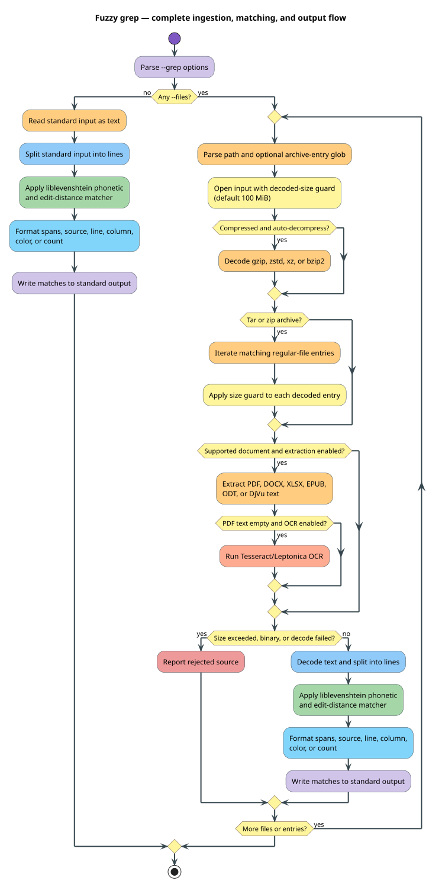

# Fuzzy grep

The grep operation applies liblevenshtein's phonetic fuzzy matcher to text
ingested from standard input, ordinary files, compressed streams, archive
entries, and supported documents. It is not a byte-for-byte clone of POSIX
`grep`: `--pattern` is compiled by the phonetic matching engine and
`--max-distance` permits approximate matches.



## Basic syntax

```bash
liblevenshtein --grep --pattern "fone" --files notes.txt \
  --max-distance 1 --line-number --column
```

Repeat `--files` for multiple inputs. With no `--files`, input is read from
standard input:

```bash
printf '%s\n' 'telephone' 'graph' | \
  liblevenshtein --grep --pattern "telefone" --max-distance 2
```

Use `--rules PATH` to apply a `.llev` source or compiled phonetic rule set.
`--ignore-case` compiles a case-insensitive matcher. `--algorithm` chooses the
underlying edit model.

## Input formats and feature ownership

| Input | Feature | Application-only dependencies |
|---|---|---|
| gzip, zstd, xz, bzip2 | `grep-compression` | `flate2`, `zstd`, `xz2`, `bzip2` |
| tar and zip | `grep-archives` | `tar`, `zip`, `globset` |
| PDF | `grep-pdf` | `pdf-extract`, `gag` |
| DOCX | `grep-docx` | `docx-rs` |
| XLSX | `grep-xlsx` | `calamine` |
| EPUB and ODT | `grep-epub`, `grep-odt` | `quick-xml`, `zip` |
| image-based PDF OCR | `grep-pdf-ocr` | `leptess`, `tempfile`, native Tesseract/Leptonica |

These packages live in `liblevenshtein-cli`; none is a normal dependency of the
`liblevenshtein` library crate. `grep-full` enables the pure-Rust grep groups and
document extractors but deliberately excludes OCR.

## Archive and document syntax

```bash
liblevenshtein --grep --pattern "timeout" \
  --files 'logs.tar.gz:services/**/*.log' --archive-filter '*.log'
liblevenshtein --grep --pattern "invoice" \
  --files reports.zip --extract-documents --max-file-size 52428800
liblevenshtein --grep --pattern "receipt" \
  --files scanned.pdf --ocr --ocr-lang eng
```

An archive path may carry an entry glob after an unescaped colon. A Windows
drive-letter colon is recognized; write `\:` for another literal colon.
`--archive-filter` supplies a default glob when a path has no inline filter.
Document extraction is enabled by default when document features are compiled;
`--extract-documents` is an explicit request useful in scripts. OCR additionally
requires the `grep-pdf-ocr` feature and native libraries.

## Output options

| Option | Semantics |
|---|---|
| `--with-filename` | Always identify each source. |
| `--no-filename` | Never identify the source; takes precedence. |
| `--line-number`, `-n` | Print one-based line numbers. |
| `--column` | Print match columns. |
| `--only-matching`, `-O` | Print only the matching span. |
| `--count` | Print match counts instead of individual matches. |
| `--no-color` | Disable ANSI color output. |

Without an explicit filename option, filenames are shown for multiple files or
standard input and omitted for one file.

## Resource and trust boundaries

The ingestion pipeline materializes each decoded file or archive entry before
line matching. The default per-file or per-entry decoded-size limit is 100 MiB.
`--max-file-size BYTES` changes that bound; it is applied while reading so an
oversized decompressed stream is rejected rather than fully accumulated.
`--no-decompress` treats compressed inputs as ordinary bytes. Hidden files are
excluded unless `--hidden` is supplied, and binary content containing a NUL byte
is rejected after any document extraction.

Standard input is accumulated separately and is not governed by
`--max-file-size`. When standard input is untrusted, bound it upstream or run the
process with an operating-system memory limit.

For hostile corpora, retain a finite size bound and add operating-system memory
and time limits. Complex document parsers and OCR engines expand the attack
surface; enable only the feature groups required for the deployment. The full
threat model is in [Security](../security.md).

[← Command-line reference](README.md)
