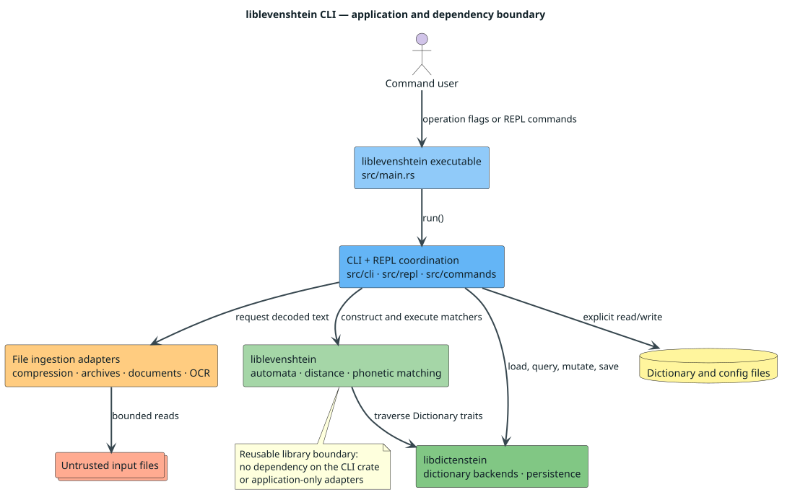

# Application architecture

`liblevenshtein-cli` is an application crate around the reusable
`liblevenshtein` and `libdictenstein` libraries. The split makes dependency
direction explicit: applications depend on libraries, while neither library
depends on this crate or its parsers, terminal UI, archive, document, or optical
character recognition (OCR) packages.



## Components

| Directory | Responsibility |
|---|---|
| `src/cli` | Parse operation flags, detect formats, load persistent settings, and dispatch one-shot commands. |
| `src/repl` | Parse interactive commands and retain session state. |
| `src/commands` | Share backend-neutral query primitives between CLI and REPL. |
| `src/grep` | Detect, bound, decode, and extract file content before matching. |
| `src/main.rs` | Thin executable wrapper. |
| `src/lib.rs` | Exposes only `liblevenshtein_cli::run()` to the wrapper. |

The application modules are private. They may change without compatibility
guarantees and must not become a second general-purpose library API. Reusable
automata or matching behavior belongs in `liblevenshtein`; reusable dictionary
behavior belongs in `libdictenstein`.

## Control flow

1. Clap parses exactly one operation flag into `cli::args::Cli`.
2. `run()` handles REPL startup or delegates a one-shot operation.
3. Dictionary commands use shared handlers over a backend container.
4. Grep commands route untrusted bytes through bounded adapters and then invoke
   the library's phonetic matcher.
5. The executable maps success or failure to a process exit status.

This arrangement keeps user-interface policy and input-format dependencies at
the application edge while the library remains independently embeddable.

## Dependency rule

```text
liblevenshtein-cli -> liblevenshtein -> libdictenstein
                   -> libdictenstein
                   -> terminal/file-format adapters
```

The arrows mean “depends on.” A reverse arrow from either library into the CLI
is an architectural violation. CI in the library repository checks that
application-only packages do not re-enter its normal dependency graph.

[← Documentation index](../README.md)
